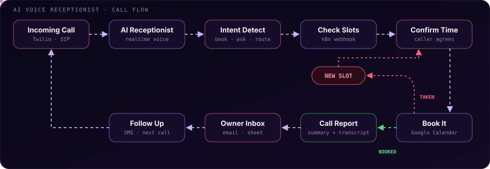

<p align="center">
  
</p>

<p align="center">
  
</p>

<p align="center">
  <a href="https://selwynbuilds.com"></a>
  <a href="https://www.youtube.com/@SelwynBuilds-j1s"></a>
  <a href="mailto:selwyn@selwynbuilds.com"></a>
  
</p>

<br />

```ts
const selwyn = {
  based:    "Iloilo, Philippines",
  role:     "AI Automation Engineer · Software Engineer (BSIT)",
  ships:    ["AI voice agents", "n8n automation systems", "AI app builders", "content pipelines"],
  teaches:  "Selwyn Builds Academy, 1,500+ members learning n8n and AI automation",
  motto:    "If a human does it twice, it should be a workflow.",
};
```

<br />

## ◆ What I Build

<table>
  <tr>
    <td width="50%" valign="top">
      <h3>📞 AI Voice Agents</h3>
      AI receptionists that pick up every call, answer questions, check real calendar slots, book the appointment and email the owner a full call report with summary, transcript and sentiment.
      <br /><br />
      
      
      
      
    </td>
    <td width="50%" valign="top">
      <h3>⚡ n8n Automation Systems</h3>
      Production workflows for real businesses. Lead generation from maps data, cold email with safe sending caps, social and community outreach, CRM syncing and reporting that lands in the inbox every morning.
      <br /><br />
      
      
      
      
    </td>
  </tr>
  <tr>
    <td width="50%" valign="top">
      <h3>🎬 AI Content Factory</h3>
      Faceless video pipelines that go from idea to finished short with no editor. AI video and image generation, voiceover, FFmpeg assembly, Drive storage and a Sheets log of every render.
      <br /><br />
      
      
      
      
    </td>
    <td width="50%" valign="top">
      <h3>🧩 AI App Builder</h3>
      A platform that turns a plain idea into a real, working web app with preview, deploy and hosting in one place. Currently in private beta.
      <br /><br />
      
      
      
      
    </td>
  </tr>
  <tr>
    <td width="50%" valign="top">
      <h3>🕸️ Browser Automation at Scale</h3>
      Multi worker Playwright systems with proxy rotation, page type detection and CSV driven flows, deployed to the cloud and built to keep running.
      <br /><br />
      
      
      
    </td>
    <td width="50%" valign="top">
      <h3>🎓 Selwyn Builds Academy</h3>
      A free n8n and AI automation course with 1,500+ members. Lead generation, voice agents, PDF handouts and quizzes, all built from real client work.
      <br /><br />
      
      
    </td>
  </tr>
</table>

<br />

## ◆ How a Voice Agent Call Flows

<p align="center">
  
</p>

<details>
<summary><b>What happens on every call</b></summary>
<br />

1. The call comes in and the AI receptionist answers in a natural realtime voice.
2. It works out what the caller wants, a booking, a question, or a transfer to a human.
3. For bookings it calls an n8n webhook that reads live calendar availability.
4. If the slot is taken it offers the next open one until the caller agrees.
5. The appointment lands on the calendar and the owner gets a call report by email.
6. Follow ups go out automatically so no lead is left waiting.

</details>

<br />

## ◆ Toolbox

<p align="center">
  
  <br />
  
  <br />
  
</p>

<p align="center">
  
  
  
  
  
  
  
  
</p>

<br />

## ◆ GitHub Activity

<p align="center">
  
</p>

<p align="center">
  
</p>

<p align="center">
  <picture>
    <source media="(prefers-color-scheme: dark)" srcset="https://raw.githubusercontent.com/RandomSci/Randomsci/output/github-snake-dark.svg" />
    <source media="(prefers-color-scheme: light)" srcset="https://raw.githubusercontent.com/RandomSci/Randomsci/output/github-snake.svg" />
    
  </picture>
</p>

<br />

<p align="center">
  <b>Have a process that eats your week?</b><br />
  <sub>Send it over. If it repeats, I can probably automate it.</sub>
</p>

<p align="center">
  
</p>
